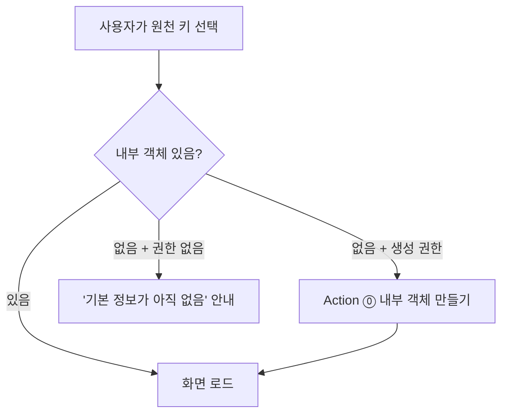
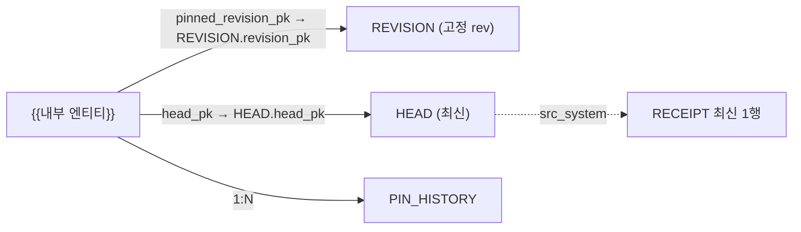

# U1 기본 정보 화면 ↔ Ontology 연동 (공개용)

> 이 문서는 퍼블릭 repo로 공유된다. 업무 내용은 `{{빈칸}}`으로 둔다.
> **내부 AI에게:** 맨 아래 "채울 것" 표를 먼저 채운다. 모르면 사용자에게 표의 질문을 그대로 묻는다. 채운 값은 퍼블릭 repo에 다시 올리지 않는다.
> 선행 문서: [source-revision.md](source-revision.md) (D7 설계), [source-revision-impl.md](source-revision-impl.md) (D7 구현 명세). 이름·규칙은 구현 명세를 따른다.
> 상태: 초안 rev 3 (2026-10-21). 범위 = "원천 값 조회 + 내부 값 편집 + 리비전 올리기" (사용자 결정, 10-21).
> rev 2 변경: 내부 객체 생성 경로 추가, 원천 객체 권한 경로 추가, 상태 판정 1개로 통일, 비교 규칙을 D7 구현에 맞춤, 동시성 보장 범위 좁힘.
> rev 3 변경: S8 + 차이 0개를 정상으로 정정, S7을 화면 판정 1개로 통일, 동시 성공은 "가능성"으로만 표기.

## 결론

- 화면 1개 = `{{내부 엔티티}}` 객체 1개의 기본 정보.
- 내부 객체가 없으면 만든다 (Action ⓪). 데모 경로나 로컬 상태로 대신하지 않는다.
- 위쪽 = 원천 값. **고정 리비전**의 REVISION 객체에서 읽는다. 조회만.
- 아래쪽 = 내부 값. Action ①로만 편집.
- 원천 상태는 판정표 1개로 정한다. 배지는 항상 보인다 (숨기지 않음).
- 리비전 올리기 = Action ②. HEAD와 비교해 보여 주고, 사유를 받고, 이력을 남긴다.
- 원천 값은 앱에서 편집하지 않는다 (D4, D7). 편집하면 이후 데이터셋 값이 가려진다. ([How user edits are applied](https://www.palantir.com/docs/foundry/object-edits/how-edits-applied/))

## 화면 흐름

- 실제 원천 키를 고르면 항상 이 흐름을 탄다. 데모 경로는 개발 모드에서만 둔다 (`{{데모 모드 스위치}}`).
- "내부 객체 있음?" = 내부 객체를 PK로 1건 조회. 404면 "없음 또는 권한 없음"이다. 둘을 화면에서 구분하지 않는다.

## 화면 영역

| 영역 | 내용 | 데이터 출처 | 편집 |
|---|---|---|---|
| A. 원천 정보 | `{{원천 표시 필드 목록}}` | REVISION 객체 (고정 rev) | 안 됨 |
| B. 상태 배지 | "원천 v{pinned}" + 상태 배지 (판정표) | 내부 객체 + HEAD 객체 | 안 됨 |
| C. 차이 보기 | 고정 rev vs HEAD 필드별 차이 | REVISION 1행 + HEAD 1행 | 안 됨 |
| D. 내부 정보 | `{{내부 편집 필드 목록}}` | 내부 객체 | Action ① |
| E. 리비전 올리기 버튼 | HEAD rev로 고정 변경 | Action ② | 권한자만 |
| F. 마지막 확인 시각 | 원천 마지막 수신 시각 | RECEIPT 최신 1행 | 안 됨 |

- 영역 A의 필드는 `COMPARE_COLS`에 들어 있어야 한다. `KEEP_COLS`에만 있는 필드는 바뀌어도 새 리비전이 안 생긴다. 그래서 화면 값이 원천과 달라도 배지가 안 뜬다. 넣지 못하는 필드는 화면에 "리비전 시점 값"이라고 표시한다.
- 리비전 표시 형식: 원천 = `{{원천 리비전 표시 형식}}` (제안: "S0, S1…"). 내부 = `{{내부 리비전 표시 형식}}`. 두 번호를 섞지 않는다 (D7 격리 규칙).

## Object Type과 Link

| Object Type | PK | 역할 | 값 출처 |
|---|---|---|---|
| `{{원천코드}}_REVISION` | `revision_pk` | 모든 리비전. 고정 참조 대상 | transform (D7 구현) |
| `{{원천코드}}_HEAD` | `head_pk` | 키별 최신 1행 = 최신 REVISION과 같은 값 | transform (D7 구현) |
| `{{원천코드}}_RECEIPT` | `receipt_id` | 수신 기록 | transform (D7 구현) |
| `{{내부 엔티티}}` | `{{내부 PK 규칙}}` | 화면의 주인 | Action ⓪ ① ② |
| `{{내부 엔티티}}_PIN_HISTORY` | 생성 ID | 리비전 올리기 이력 | Action ⓪ ② |

내부 엔티티 속성 (원천 연결용, 모두 Action만 씀):

| 속성 | 뜻 | 처음 값 (Action ⓪) |
|---|---|---|
| `src_system` | 원천 코드 | 선택한 원천 |
| `{{KEY}}` | 원천 키 | 선택한 키 |
| `pinned_src_rev_no` | 고정 리비전 번호 | 그때 HEAD의 `src_rev_no` |
| `pinned_revision_pk` | REVISION PK. Link 외래 키 (FK) | `src_system` + `_` + 키 + `_` + 고정 rev |
| `head_pk` | HEAD PK. Link 외래 키 | `src_system` + `_` + 키 |
| `work_version` | 저장 충돌 감지 번호 | 1 |
| `viewerGroupIds` | 행 권한 그룹 ID | `{{초기 권한 규칙}}` |
| `pinned_by` / `pinned_at` | 마지막으로 고정을 바꾼 사람·시각 | 만든 사람·시각 |

Link Type 2개 (내부 엔티티 → 원천, 다대일):

- PK 문자열 규칙은 D7 구현의 `revision_pk`, `head_pk`와 글자 하나까지 같아야 한다. 다르면 Link가 빈다.
- 문자열 조합은 규칙 기반 Action이 못 한다 → 모든 Action은 Function-backed (PoC 관찰).
- 원천 키 1개당 내부 객체 수 = `{{키당 내부 객체 수}}` (기본 가정: 1개).
- 확인 필요: 회사 온톨로지(legacy 권한 모델)에서 edit-only 속성을 Link FK로 쓸 수 있는지.

## Action ⓪ 내부 객체 만들기

| 파라미터 | 형식 | 규칙 |
|---|---|---|
| `src_system` | 문자열 | 원천 목록 중 1개 |
| `{{KEY}}` | 원천 키 형식 | HEAD에 있어야 함 |
| `{{내부 처음 필드}}` | `{{형식}}` | `{{검증 규칙}}` |

함수가 하는 일:

1. HEAD를 `head_pk`로 읽는다. 없으면 거부.
2. HEAD의 `change_type`이 DELETE 또는 OUT_OF_SCOPE면 거부 ("원천에 없는 키").
3. 같은 내부 PK 객체가 이미 있으면 거부 ("이미 있음. 새로 불러오기").
4. 내부 객체 생성. 위 표의 처음 값.
5. 권한 배정: HEAD 1행과 고정 REVISION 1행의 `viewerGroupIds`에 내부 객체 그룹을 넣는다 (아래 "원천 객체 권한").
6. PIN_HISTORY 1건 (이전 rev = 없음, 사유 = "생성").

- 제출 조건: `{{생성 권한 그룹}}`. 이 그룹은 아직 권한이 없는 HEAD도 볼 수 있어야 한다 (행 정책의 관리자 그룹 상수 조건).
- 확인 필요: 같은 PK를 두 사람이 동시에 만들 때 거부되는지, 덮어쓰는지. ([action-concurrency PoC](../poc/action-concurrency/design.md) U2)
- 이미 있는 데이터 이관: `{{기존 내부 데이터 이관}}` (없으면 "해당 없음").

## 원천 객체 권한

규칙 1개: **원천 객체 1행의 `viewerGroupIds` = 그 키를 쓰는 내부 객체들의 `viewerGroupIds` 합집합 + 관리자 그룹.**

| 언제 | 대상 행 | 누가 배정 |
|---|---|---|
| 내부 객체 만들 때 | HEAD 1행, 고정 REVISION 1행 | Action ⓪ |
| transform이 새 REVISION 행을 만들 때 | 새 REVISION 행 | 재동기화 Action (아래) |
| 내부 객체 권한이 바뀔 때 | 그 키의 HEAD, 모든 REVISION 행 | 재동기화 Action |
| 아직 내부 객체가 없는 키 | 없음 | 관리자 그룹만 봄 |

- 재동기화 Action = 키 1개를 받아 위 규칙대로 다시 계산 (keystone PoC의 resync 패턴과 같음).
- 실행 방법 (1순위): Automate가 새 REVISION 객체를 감지해 재동기화 Action 실행. ([Automate](https://www.palantir.com/docs/foundry/automate/overview))
- 실행 방법 (대안): Automate 시간 스케줄로 주기 실행 `{{재동기화 주기}}`.
- HEAD는 PK가 그대로라서 한 번 배정하면 transform 재빌드 뒤에도 값이 남는다 (edit-only 속성, PoC 관찰). HEAD 행은 지워지지 않는다 (삭제도 DELETE 리비전).
- 차이 보기(C)는 HEAD를 쓴다. 그래서 새 REVISION 행 권한이 늦어도 차이 보기는 된다.
- 배정 전 새 REVISION 행은 일반 사용자에게 안 보인다. 그동안 리비전 올리기는 "권한 배정 대기"로 막는다 (판정표).
- 확인 필요: 6.550.1에서 Automate가 transform이 만든 객체 추가를 감지하는지. Automate가 Action을 누구 권한으로 실행하는지.
- 확인 필요: legacy 온톨로지에서 edit-only 속성 + 행 정책 동작 (D30 남은 과제).

## 화면 로드 순서 (OSDK)

| 순서 | 무엇 | OSDK 동작 | 없을 때 |
|---|---|---|---|
| 1 | 내부 객체 1개 | PK로 1건 조회 | 화면 흐름의 "없음" 분기 |
| 2 | 고정 REVISION | Link 따라가기 | 판정표 S1 |
| 3 | HEAD | Link 따라가기 | 판정표 S2 |
| 3a | HEAD rev의 REVISION | HEAD.`revision_pk`로 1건 조회. HEAD.`src_rev_no` > pinned일 때만 | 판정표 S7 |
| 4 | RECEIPT 최신 1행 | `src_system` 필터 + 시각 내림차순 1건 | "확인 시각 없음" |
| 5 | 내 권한 | 앱 권한 판정 (D6 / KS 권한 패턴) | 편집 버튼 숨김 |

- 2~4는 1 다음에 병렬로 부른다. 3a는 3 다음.
- 배지는 2, 3, 3a 결과로 판정표가 정한다. 로드 표는 배지를 따로 정하지 않는다.
- 근거: [TypeScript OSDK](https://www.palantir.com/docs/foundry/ontology-sdk/typescript-osdk/)

## 상태 판정표 (하나만 씀)

위에서 아래로 처음 맞는 줄 1개만 쓴다. 배지는 항상 보인다. "최신"도 배지다.

| # | 조건 | 배지 | 리비전 올리기 |
|---|---|---|---|
| S1 | 고정 REVISION 못 읽음 | "원천 값 확인 불가" | 막음 |
| S2 | HEAD 못 읽음 | "원천 확인 불가" | 막음 |
| S3 | HEAD.`src_rev_no` < pinned | "데이터 오류" + 관리자 알림 | 막음 |
| S4 | HEAD.`change_type` = DELETE | "원천에서 삭제됨" | 막음 (`{{삭제 시 처리}}`) |
| S5 | HEAD.`change_type` = OUT_OF_SCOPE | "범위 밖" | 막음 (`{{범위 밖 처리}}`) |
| S6 | HEAD.`src_rev_no` = pinned | "최신" | 숨김 |
| S7 | HEAD.`src_rev_no` > pinned, 3a 결과 없음 | "새 리비전 있음 (권한 배정 대기)" | 버튼 비활성 |
| S8 | HEAD.`src_rev_no` > pinned, 3a 결과 있음 | "새 리비전 있음" | 가능 |

- S4·S5는 rev 비교보다 먼저다. 그래서 고정 rev가 HEAD와 같아도 HEAD가 DELETE면 "원천에서 삭제됨"이 보인다.
- 정상 흐름에서는 고정 rev가 DELETE·OUT_OF_SCOPE 행을 가리키지 않는다 (Action ⓪·②가 막음). 그래도 판정표는 그 경우를 S4·S5로 처리한다.
- S1·S2는 "없음"과 "권한 없음"을 구분하지 않는다 (OSDK가 둘 다 빈 결과).
- S7·S8은 화면이 로드 순서 3a로 판정한다. 화면은 S7 배지를 보이고 버튼을 비활성으로 둔다.
- Action ② 함수도 같은 조건을 다시 확인한다 (화면을 연 뒤 상태가 바뀔 수 있음). 거부 메시지는 S7 배지 문구와 같다.

## 차이 보기 규칙 (D7 구현과 같게)

- 비교 대상 = 고정 REVISION 1행 vs HEAD 1행.
- 비교 필드 = `COMPARE_COLS` (D7 구현 설정값). 같은 설정을 읽는다. 따로 목록을 두지 않는다.
- 값 비교 = D7 해시 규칙 2~3번과 같게:
  - 문자열로 바꾸고 앞뒤 공백만 지운다. 다른 정규화(숫자 형식, 대소문자)는 하지 않는다.
  - null과 `""`는 다르다.
- 같은 필드는 접고, 다른 필드만 "이전 값 → 새 값".
- S8이어도 차이 필드가 0개일 수 있다. 정상이다. 예: 고정 rev 뒤에 값이 바뀌었다가 원래 값으로 돌아옴 (x → y → x), 삭제 뒤 같은 값으로 REINSERT. 이때 "값 차이 없음, 리비전 번호만 바뀜"을 보여 주고 리비전 올리기는 그대로 허용한다.
- 화면 비교가 D7 해시 규칙과 어긋났는지는 차이 보기로 판정하지 않는다. 테스트 시나리오 7·8로 확인한다.
- HEAD가 DELETE·OUT_OF_SCOPE면 값이 마지막 값 그대로라서 차이가 0개일 수 있다. 이때는 차이 보기 대신 판정표 배지만 보인다.

## Action ① 내부 정보 편집

| 파라미터 | 형식 | 규칙 |
|---|---|---|
| 대상 객체 | 내부 엔티티 | 필수 |
| `{{내부 편집 필드}}` 각각 | `{{형식}}` | `{{검증 규칙}}` |
| `expected_work_version` | 정수 | 화면이 읽은 값 |

- 함수가 `work_version`을 읽어 `expected_work_version`과 다르면 `UserFacingError`로 거부: "다른 사람이 먼저 저장. 새로 불러온 뒤 다시". ([User-facing errors](https://www.palantir.com/docs/foundry/functions/user-facing-error/))
- 성공하면 `work_version + 1`.
- 원천 연결 속성은 파라미터에 없다.
- 제출 조건: `{{편집 권한 그룹}}` + 행 권한. ([Submission criteria](https://www.palantir.com/docs/foundry/action-types/submission-criteria/))
- 주의: 제출 조건 불충족은 HTTP 200 + `validation: INVALID`. 화면에서 성공으로 처리하지 않는다 (PoC 관찰).

## Action ② 리비전 올리기

| 파라미터 | 형식 | 규칙 |
|---|---|---|
| 대상 객체 | 내부 엔티티 | 필수 |
| `target_src_rev_no` | 정수 | 화면이 차이 보기에서 본 HEAD rev |
| `reason` | 문자열 | 필수. `{{사유 최소 길이}}` |
| `expected_work_version` | 정수 | 화면이 읽은 값 |

함수가 하는 일:

1. 내부 객체 `work_version` 확인. 다르면 거부.
2. HEAD를 읽는다. `src_rev_no` ≠ `target_src_rev_no`면 거부 ("원천이 또 바뀜. 차이를 다시 확인").
3. 판정표 S3~S5면 거부.
4. 대상 REVISION (`revision_pk`)을 읽는다. 못 읽으면 거부 ("권한 배정 대기", S7).
5. 내부 객체: `pinned_src_rev_no`, `pinned_revision_pk`, `pinned_by`, `pinned_at`, `work_version + 1`.
6. PIN_HISTORY 1건: 이전 rev, 새 rev, 사람, 시각, 사유.

- 제출 조건: `{{리비전 올리기 권한 그룹}}`. 내부 정보 편집 권한과 분리 (기능 권한).
- 하위 영향: 고정 rev를 쓰는 하위 계산(`{{하위 계산}}`)은 다음 빌드에서 바뀐다. 하위 파이프라인이 고정 rev를 읽으려면 내부 객체 materialization이 필요하다 (D3와 같은 방식). ([Materializations](https://www.palantir.com/docs/foundry/object-edits/materializations/))
- 확인 필요: 내부 리비전이 이미 잠긴 경우 고정 rev 변경을 막을지. → `{{잠금 후 변경 규칙}}`

## 동시성: 보장하는 것과 안 하는 것

| 상황 | 이 설계가 하는 것 | 보장 수준 |
|---|---|---|
| 화면을 오래 열어 둔 사이 다른 사람이 저장 | `work_version` 비교로 거부 | 함수가 읽는 시점 기준. 감지함 |
| 두 요청이 거의 동시에 같은 `work_version`을 읽음 | 둘 다 성공할 **가능성**이 있음. Action 격리 설정과 PoC 결과 전에는 미확인 | **보장 안 함.** 확인 필요 ([action-concurrency PoC](../poc/action-concurrency/design.md) U4) |
| 함수가 HEAD를 읽은 직후 transform이 HEAD 갱신 | 고정 rev = 그때 읽은 rev. 다음 로드에 다시 "새 리비전 있음" | 데이터는 안 깨짐 (REVISION 행은 안 바뀜). 최신 보장은 안 함 |
| 같은 내부 PK 동시 생성 (Action ⓪) | 3번 단계에서 거부 시도. 둘 다 성공(덮어쓰기)할 **가능성**은 미확인 | 보장 안 함. 확인 필요 (PoC U2) |

- 지금 표현: "늦게 읽은 화면의 저장을 막는다"까지만. "동시 저장을 막는다"고 쓰지 않는다.
- PoC U2·U4 결과가 "둘 다 성공"이면 보완책: 버전 slot 객체 (PK = 내부 PK + `#` + 버전)를 같은 Action에서 만들어 PK 충돌로 막는다 (PoC E6). 결과 나오면 이 표를 고친다.

## 권한 (요약)

- REVISION · HEAD · RECEIPT · 내부 엔티티 · PIN_HISTORY 모두 `viewerGroupIds` 행 정책 (D30). 정책 없는 타입은 사용자에게 아무것도 안 보인다 (PoC 관찰). ([Object security policies](https://www.palantir.com/docs/foundry/object-permissioning/object-security-policies/))
- 원천 객체 배정 경로 = 위 "원천 객체 권한".
- RECEIPT는 행이 키가 아니라 실행 단위다. `{{RECEIPT 권한 규칙}}` (기본 제안: 앱 사용자 그룹 전체 조회. 업무 값 없음).
- 필드 단위로 숨길 원천 필드: `{{숨길 필드}}`. 방식은 확인 필요 (속성 단위 보안 기능이 6.550.1에 있는지).

## 테스트 시나리오

| # | 준비 | 동작 | 기대 |
|---|---|---|---|
| 1 | 내부 객체 없음, 생성 권한 있음 | 키 선택 | Action ⓪ 화면. 만들면 pinned = HEAD rev, 배지 "최신" (S6) |
| 2 | 내부 객체 없음, 생성 권한 없음 | 키 선택 | "기본 정보가 아직 없음". 데모 값 안 보임 |
| 3 | HEAD가 DELETE인 키 | Action ⓪ | 거부 |
| 4 | pinned = HEAD | 화면 열기 | "최신" 배지, 올리기 버튼 숨김 |
| 5 | `COMPARE_COLS` 값 1개 바꾸고 빌드, 재동기화 전 | 화면 열기 | "새 리비전 있음 (권한 배정 대기)" 배지 (S7), 차이 1개, 올리기 버튼 비활성 |
| 5a | 화면을 S8로 연 뒤 다시 원천 변경 + 빌드, 재동기화 전 | 리비전 올리기 | 거부 (Action ② 2단계: HEAD rev ≠ `target_src_rev_no`). 메시지 = "원천이 또 바뀜. 차이를 다시 확인" |
| 6 | 5 다음 재동기화 | 리비전 올리기 | pinned = HEAD, PIN_HISTORY 1건, "최신" |
| 7 | 값 앞뒤 공백만 바꾸고 빌드 | 화면 열기 | 새 리비전 없음, "최신" (D7 해시 규칙) |
| 8 | 값을 null → `""`로 바꾸고 빌드 | 화면 열기 | "새 리비전 있음", 차이 1개 |
| 8a | 고정 rev 뒤 값 x → y 빌드, 다시 y → x 빌드, 재동기화 후 | 화면 열기 | "새 리비전 있음" (S8), "값 차이 없음, 리비전 번호만 바뀜", 올리기 가능 |
| 9 | 원천에서 행 삭제 후 빌드 | 화면 열기 | "원천에서 삭제됨" (S4). 영역 A는 고정 rev 값 그대로 |
| 10 | 필터 밖으로 나감 | 화면 열기 | "범위 밖" (S5) |
| 11 | 사용자 2명, 한 명이 먼저 저장 | 다른 한 명이 저장 | 충돌 메시지 |
| 12 | 화면 연 뒤 원천 또 바뀜 | 리비전 올리기 | 거부, "다시 확인" |
| 13 | 편집 권한 없는 사용자 | 화면 열기 / API로 Action 호출 | 조회만 / INVALID |
| 14 | 행 권한 없는 사용자 | 객체 URL 직접 열기 | "없음 또는 권한 없음" |
| 15 | 리비전 transform 재빌드 | 화면 열기 | pinned 값·내부 값·HEAD 권한 그대로 |
| 16 | HEAD 행이 사라진 상태 (비정상) | 화면 열기 | "원천 확인 불가" (S2). 배지 숨기지 않음 |

## 기존 결정과 다른 점

| 기존 | 바뀜 | 이유 |
|---|---|---|
| D7: 내부는 `pinned_src_rev_no`만 가짐 | `pinned_revision_pk`, `head_pk` 문자열 FK 추가 | Link Type은 FK 1개 ↔ PK 1개 |
| D7: "리비전 올리기 = 담당자 Action" | 대상 = HEAD rev만, 사유 필수, PIN_HISTORY | 누가·왜 바꿨는지 조회 |
| D30: 새 행 권한 배정 = Action 또는 Automate (미정) | 규칙 1개 (내부 객체 그룹 합집합) + Action ⓪ + 재동기화 | 원천 객체 조회 경로를 닫음 |
| U1 rev 1: 차이 = 최신 REVISION, 자체 정규화 | 차이 = HEAD, D7 해시 규칙 그대로 | D7 구현과 맞춤 |
| U1 rev 1: "동시 저장 막음" | "늦게 읽은 저장만 막음" | PoC U4 결과 전 |

## 보고서 반영할 것

- 결정 7 (D7) 아래에 "화면 연동: Action ⓪ 생성, 고정 rev Link + HEAD Link, 리비전 올리기 Action ②" 한 줄.
- D30 남은 과제에 "원천 객체 권한 = 내부 객체 그룹 합집합, 재동기화 Action" 한 줄.
- 리스크 목록: "화면 비교 규칙이 D7 해시 규칙과 어긋나면 가짜 배지", "동시 저장은 PoC 전까지 보장 안 함".

## 채울 것 (내부 AI)

| 빈칸 | 뜻 | 어디서 확인 | 모르면 사용자에게 |
|---|---|---|---|
| `{{내부 엔티티}}` | 화면의 주인 객체 | 우리 온톨로지 | "기본 정보 화면은 어느 Object Type의 화면인가?" |
| `{{내부 PK 규칙}}` | 내부 객체 PK | 기존 Object Type | "내부 객체 PK는 어떻게 만드나?" |
| `{{키당 내부 객체 수}}` | 원천 키 1개당 내부 객체 수 | 업무 규칙 | "원천 1건에 기본 정보가 1개뿐인가?" |
| `{{원천코드}}` / `{{KEY}}` | 원천 코드·키 컬럼 | D7 구현 설정값 `SRC_SYSTEM`, `KEY` | - |
| `{{원천 표시 필드 목록}}` | 영역 A 필드 | 원천 스키마 + `COMPARE_COLS` | "원천 필드 중 화면에 보일 것은?" |
| `{{내부 편집 필드 목록}}` / `{{내부 처음 필드}}` / `{{형식}}` / `{{검증 규칙}}` | 영역 D·생성 필드 | 화면 기획 | "우리가 직접 입력하는 기본 정보 필드와 규칙은?" |
| `{{데모 모드 스위치}}` | 데모 경로를 켜는 조건 | 지금 앱 코드 | "데모 화면은 어떤 조건에서만 보여야 하나?" |
| `{{기존 내부 데이터 이관}}` | 이미 있는 데이터 처리 | 지금 앱·온톨로지 | "기존에 저장된 기본 정보가 있나? 옮겨야 하나?" |
| `{{원천 리비전 표시 형식}}` / `{{내부 리비전 표시 형식}}` | 화면 표시 | D7 남은 질문 1 | "원천 리비전을 S0처럼 보여도 되나?" |
| `{{삭제 시 처리}}` / `{{범위 밖 처리}}` | 그때 할 일 | 업무 규칙 | "원천에서 삭제되면 고정을 그대로 둘까, 따로 처리할까?" |
| `{{생성 권한 그룹}}` / `{{편집 권한 그룹}}` / `{{리비전 올리기 권한 그룹}}` | Action 제출 조건 | 권한 설계 (D6) | "누가 만들고, 편집하고, 리비전을 올리나?" |
| `{{초기 권한 규칙}}` | 새 내부 객체의 `viewerGroupIds` | 권한 설계 (D6) | "새 기본 정보는 어느 그룹에 보이나?" |
| `{{재동기화 주기}}` | 대안 실행 주기 | 원천 동기화 주기 | "권한 배정이 몇 분 늦어도 되나?" |
| `{{RECEIPT 권한 규칙}}` / `{{숨길 필드}}` | 권한 세부 | 보안 가이드 | "수신 시각은 누구나 봐도 되나? 숨길 필드 있나?" |
| `{{사유 최소 길이}}` | 사유 검증 | - | "사유 최소 몇 자?" |
| `{{하위 계산}}` | 고정 rev를 쓰는 계산 | 파이프라인 | "고정 rev 바뀌면 다시 계산되는 것은?" |
| `{{잠금 후 변경 규칙}}` | 내부 리비전 잠긴 뒤 고정 변경 | 업무 규칙 | "내부 리비전이 잠긴 뒤에도 원천 rev를 올릴 수 있나?" |
