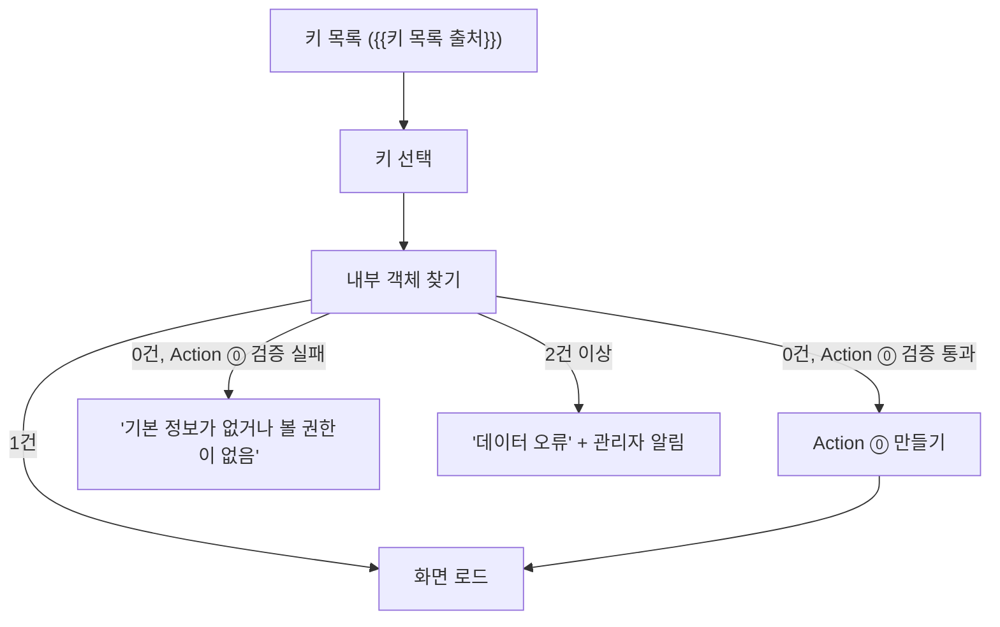
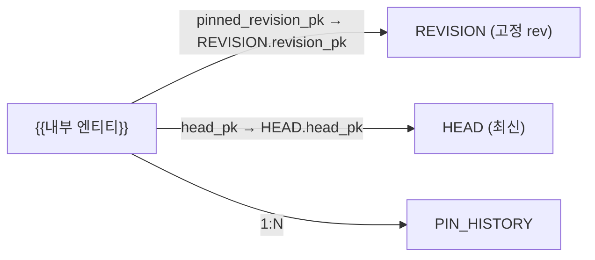

# U1 기본 정보 화면 ↔ Ontology 연동 (공개용)

> 이 문서는 퍼블릭 repo로 공유된다. 업무 내용은 `{{빈칸}}`으로 둔다 (중괄호 2쌍 = 내부 AI가 채울 자리).
> **내부 AI에게:** 맨 아래 "채울 것" 표를 먼저 채운다. 모르면 사용자에게 표의 질문을 그대로 묻는다. 채운 값은 퍼블릭 repo에 다시 올리지 않는다.
> 선행 문서: [source-revision.md](source-revision.md) (D7 설계), [source-revision-impl.md](source-revision-impl.md) (D7 구현 명세). 이름·규칙은 구현 명세를 따른다.
> 상태: 초안 rev 4 (2026-10-21). 범위 = "원천 값 조회 + 내부 값 편집 + 리비전 올리기" (사용자 결정, 10-21).
> rev 4 변경: 4개 관점(구현자, 일관성, Foundry 문서, 공개 규칙) 검증 반영. 전제조건, 재동기화 Action 명세, Function 실행 권한, 키 목록 출처, PIN_HISTORY·RECEIPT 권한, Action ② 거부 조건, 동시성 근거 정리.

## 용어

| 말 | 뜻 |
|---|---|
| D3 | 확정 데이터는 이력 데이터셋에 APPEND하는 결정 |
| D4 | 업무 객체는 파이프라인 조인으로만 만들고, 원천 값을 Action으로 고치지 않는 결정 |
| D6 | 권한 = 행 정책 + Action 제출 조건 + 마킹으로 나누는 결정 |
| D7 | 원천 리비전 격리 ([source-revision.md](source-revision.md)) |
| D30 | REVISION · HEAD 행 권한은 edit-only 속성 `viewerGroupIds` + 행 정책으로 하는 결정 |
| 고정 rev | 내부 객체가 가리키는 원천 리비전 번호 (`pinned_src_rev_no`) |
| 재동기화 | 원천 객체의 `viewerGroupIds`를 규칙대로 다시 계산해 넣는 일 (아래 Action R) |
| PoC 관찰 | 비공개 별도 Foundry PoC 환경에서 직접 해 본 결과. 이 repo에는 기록이 없다. 대상 환경에서는 "확인 필요"로 취급한다 |
| PoC U·Q·E 번호 | [action-concurrency PoC](../poc/action-concurrency/design.md)의 질문·실험 번호 (아직 실행 전) |

## 전제조건 (하나라도 아니면 구현을 멈추고 사용자에게 묻는다)

| # | 조건 | 왜 | 근거 |
|---|---|---|---|
| P1 | 원천 Object Type 3개와 내부 엔티티, PIN_HISTORY는 project-based 권한 모델 | legacy 모델은 행 정책이 있어도 백킹 데이터셋 Viewer가 필요하다. 그러면 데이터셋에서 모든 행이 보인다. project-based에서 데이터셋 Viewer 없이 정책만으로 보이는지는 문서 표현이 엇갈림 → 테스트 13으로 확인 | [Object security policies](https://www.palantir.com/docs/foundry/object-permissioning/object-security-policies/) |
| P2 | 위 Object Type이 모두 OSv2 | edit-only 속성은 OSv2에서만 된다 | [Edit-only properties](https://www.palantir.com/docs/foundry/object-link-types/edit-only-properties) |
| P3 | `{{플랫폼 버전}}`에 P1·P2 설정이 있다 | 공식 문서는 최신 버전 기준 | 확인 필요 |
| P4 | `{{키당 내부 객체 수}}` = 1 | 화면 1개 = 내부 객체 1개 전제 | 사용자 결정 |

## 결론

- 화면 1개 = `{{내부 엔티티}}` 객체 1개의 기본 정보.
- 내부 객체가 없으면 만든다 (Action ⓪). 데모 경로나 로컬 상태로 대신하지 않는다.
- 위쪽 = 원천 값. 고정 rev의 REVISION 객체에서 읽는다. 조회만.
- 아래쪽 = 내부 값. Action ①로만 편집.
- 원천 상태는 판정표 1개로 정한다. 배지는 항상 보인다.
- 리비전 올리기 = Action ②. HEAD와 비교해 보여 주고, 사유를 받고, 이력을 남긴다.
- 원천 객체 권한 = Action R (재동기화).
- 원천 값은 앱에서 편집하지 않는다 (D4, D7). 기본 충돌 전략에서는 편집하면 이후 데이터셋 값이 가려진다. ([How user edits are applied](https://www.palantir.com/docs/foundry/object-edits/how-edits-applied/))

## 화면 흐름

- 키 목록 = `{{키 목록 출처}}`. 일반 사용자는 행 권한이 있는 내부 객체 목록에서 고른다. 아직 내부 객체가 없는 키는 HEAD에서 고르는데, HEAD 전체는 관리자 그룹만 보므로 생성 권한자만 고를 수 있다.
- 내부 객체 찾기: 내부 PK를 원천 키로 만들 수 있으면 PK로 1건 조회. 아니면 `src_system` + `{{KEY}}` 속성으로 검색. 결과 0건, 1건, 2건 이상을 위 그림처럼 나눈다.
- 0건 = "없음" 또는 "권한 없음". 화면은 둘을 구분하지 않고 같은 문구를 쓴다.
- 생성 버튼을 보일지: Action ⓪을 검증만 모드로 호출해 결과가 VALID이면 보인다 (PoC 관찰: `options.mode: VALIDATE_ONLY`). 이때 파라미터는 규칙을 통과하는 `{{검증용 자리 값}}`을 넣는다. 검증만 모드가 제출 조건·파라미터 검증만 보는지, 함수 단계까지 실행하는지는 확인 필요. ([Apply action](https://www.palantir.com/docs/foundry/api/v2/ontologies-v2-resources/actions/apply-action/))
- 데모 경로는 `{{데모 모드 스위치}}`가 켜졌을 때만 쓴다.

## 화면 영역

| 영역 | 내용 | 데이터 출처 | 편집 |
|---|---|---|---|
| A. 원천 정보 | `{{원천 표시 필드 목록}}` | REVISION 객체 (고정 rev) | 안 됨 |
| B. 상태 배지 | 고정 rev 표시 + 상태 배지 (판정표) | 내부 객체 + HEAD + 3a 결과 | 안 됨 |
| C. 차이 보기 | 고정 rev vs HEAD 필드별 차이 | REVISION 1행 + HEAD 1행 | 안 됨 |
| D. 내부 정보 | `{{내부 편집 필드 목록}}` | 내부 객체 | Action ① |
| E. 리비전 올리기 버튼 | HEAD rev로 고정 변경 | Action ② | `{{리비전 올리기 권한 그룹}}`만 |
| F. 마지막 확인 시각 | 원천 마지막 수신 시각 | RECEIPT 최신 1행 | 안 됨 |
| G. 고정 변경 이력 | 누가·언제·어느 rev로·왜 | PIN_HISTORY | 안 됨 |

- 영역 A의 필드는 `COMPARE_COLS`에 들어 있어야 한다. `KEEP_COLS`에만 있는 필드는 바뀌어도 새 리비전이 안 생긴다. 넣지 못하는 필드는 화면에 "리비전 시점 값"이라고 표시한다.
- 리비전 표시: 원천 = `{{원천 엔티티 약어}} v0, v1…`, 내부 = `{{내부 엔티티 약어}} R00, R01…` ([source-revision.md](source-revision.md) "화면 표시"). 두 번호를 섞지 않는다.

## Object Type과 Link

| Object Type | PK | 역할 | 값 출처 | 행 권한 |
|---|---|---|---|---|
| `{{원천코드}}_REVISION` | `revision_pk` | 모든 리비전. 고정 참조 대상 | transform | edit-only `viewerGroupIds` (Action R) |
| `{{원천코드}}_HEAD` | `head_pk` | 키별 최신 1행 = 최신 REVISION과 같은 값 | transform | edit-only `viewerGroupIds` (Action R) |
| `{{원천코드}}_RECEIPT` | `receipt_id` | 수신 기록 (키 없음) | transform | 정책 상수 `{{앱 사용자 그룹}}` |
| `{{내부 엔티티}}` | `{{내부 PK 규칙}}` | 화면의 주인 | Action ⓪ ① ② | `viewerGroupIds` |
| `{{내부 엔티티}}_PIN_HISTORY` | 생성 ID | 고정 변경 이력 | Action ⓪ ② | `viewerGroupIds` (내부 객체 값 복사) |

내부 엔티티 속성 (원천 연결용, 모두 Action만 씀):

| 속성 | 뜻 | 처음 값 (Action ⓪) |
|---|---|---|
| `src_system` | 원천 코드 | 선택한 원천 |
| `{{KEY}}` | 원천 키 | 선택한 키 |
| `pinned_src_rev_no` | 고정 rev | 그때 HEAD의 `src_rev_no` |
| `pinned_revision_pk` | REVISION PK. Link 외래 키 (FK) | `src_system` + `_` + 키 문자열 + `_` + 고정 rev |
| `head_pk` | HEAD PK. Link 외래 키 | `src_system` + `_` + 키 문자열 |
| `work_version` | 저장 충돌 감지 번호 | 1 |
| `viewerGroupIds` | 행 권한 그룹 ID | `{{초기 권한 규칙}}` (만든 사람이 속한 그룹을 꼭 포함) |
| `pinned_by` / `pinned_at` | 마지막으로 고정을 바꾼 사람·시각 | 만든 사람·시각 |

Link Type 3개:

- 키 문자열 = 구현 명세의 `{{키 문자열 규칙}}`. Action 함수와 transform이 같은 규칙을 쓴다. 다르면 Link가 빈다.
- FK가 문자열 조합이라 규칙 기반 Action으로는 못 만든다 → Action ⓪ ① ② R은 모두 Function-backed (PoC 관찰).
- Link FK는 PK를 가리켜야 한다 ([Create a link type](https://www.palantir.com/docs/foundry/object-link-types/create-link-type)). Action이 쓰는 속성(edit-only 또는 내부 객체의 편집 속성)을 FK로 쓸 수 있는지는 문서에 없다 → 확인 필요. 안 되면 Link 대신 화면이 FK 값으로 PK 조회를 한다.

## 함수 실행 권한 (모든 Action 공통)

- Function-backed Action의 함수는 **제출한 사용자 권한**으로 객체를 읽는다. 행 정책에 가린 객체는 함수도 못 본다 (PoC 관찰).
- 객체를 편집하려면 제출자가 그 Object Type을 볼 수 있어야 한다. 행이 안 보이는 객체를 편집할 수 있는지는 문서에 없다 → 확인 필요.
- 그래서 다른 사람의 객체를 읽거나 쓰는 Action(⓪, R, `{{권한 변경 Action}}`)은 제출 조건이 `{{관리자 그룹}}` 안이어야 한다.
- Action 설정 (⓪ ① ② R 공통): Write mode = Batched writes, Isolation = Snapshot isolation, 일시 오류 재시도 = 끔. PoC 결과가 이 설정에서만 유효하기 때문 ([action-concurrency PoC](../poc/action-concurrency/design.md) §3). `{{플랫폼 버전}}`에 이 설정이 있는지 확인 필요.

## Action ⓪ 내부 객체 만들기

| 파라미터 | 형식 | 규칙 |
|---|---|---|
| `src_system` | 문자열 | 원천 목록 중 1개 |
| `{{KEY}}` | 원천 키 형식 | HEAD에 있어야 함 |
| `{{내부 처음 필드 목록}}` | 필드별 `{{형식}}` | `{{검증 규칙}}` |

함수 단계:

1. HEAD를 `head_pk`로 읽는다. 없으면 거부.
2. HEAD `change_type`이 DELETE 또는 OUT_OF_SCOPE면 거부 ("원천에 없는 키").
3. 같은 키의 내부 객체를 찾는다. 있으면 거부 ("이미 있음. 새로 불러오기").
4. 내부 객체 생성 (위 표의 처음 값).
5. PIN_HISTORY 1건 (이전 rev = 없음, 새 rev = 고정 rev, 사유 = "생성", `viewerGroupIds` = 내부 객체 값).
6. Action R의 계산을 이 키에 실행 (같은 함수 코드). 같은 함수 안에서 만든 객체는 아직 검색에 안 나온다 → 검색 결과에 4단계 객체의 새 `viewerGroupIds`를 직접 더해 합집합을 만든다.

- 제출 조건: `{{생성 권한 그룹}}`. 이 그룹은 `{{관리자 그룹}}` 안에 있어야 한다 (3·6단계 때문).
- 확인 필요: 같은 키를 두 사람이 동시에 만들 때 결과 (아래 동시성 표).
- 이미 있는 데이터 이관: `{{기존 내부 데이터 이관}}` (없으면 "해당 없음").

## Action R 원천 권한 재동기화

규칙: **원천 키 1개의 HEAD 1행과 모든 REVISION 행의 `viewerGroupIds` = 그 키를 쓰는 내부 객체들의 `viewerGroupIds` 합집합 + `{{관리자 그룹}}`.** PIN_HISTORY는 자기 내부 객체 값과 같다.

| 파라미터 | 형식 | 규칙 |
|---|---|---|
| `src_system` | 문자열 | 필수 |
| `{{KEY}}` | 원천 키 형식 | 필수 |

함수 단계:

1. `src_system` + `{{KEY}}`로 내부 객체 전부 검색.
2. 그 객체들의 `viewerGroupIds` 합집합 + `{{관리자 그룹}}` 계산.
3. HEAD 1행과 그 키의 REVISION 전부: `viewerGroupIds`를 2의 값으로 **교체**.
4. 1의 내부 객체마다 PIN_HISTORY 전부: `viewerGroupIds`를 그 내부 객체 값으로 교체.

언제 실행하나:

| 언제 | 누가 실행 |
|---|---|
| Action ⓪ 안에서 | Action ⓪ 6단계 |
| transform이 새 REVISION 행을 만들 때 | Automate (아래) |
| 내부 객체 권한이 바뀔 때 | `{{권한 변경 Action}}`이 끝에 같은 계산 실행. 검색 결과의 그 객체는 옛 값이므로 빼고 새 값을 직접 넣는다 |
| 주기 점검 (누락 대비) | Automate 시간 스케줄 `{{재동기화 주기}}` |

- 제출 조건: `{{관리자 그룹}}`.
- Automate: 조건 = 새 REVISION 객체가 집합에 추가됨, 효과 = Action R. 백킹 데이터셋 변경도 감지하지만 보통 몇 분 늦다. Action은 automation owner 권한으로 실행된다 → owner는 `{{관리자 그룹}}` 계정. owner 계정이 꺼지면 멈춘다. ([Object conditions](https://www.palantir.com/docs/foundry/automate/condition-objects), [Action effects](https://www.palantir.com/docs/foundry/automate/effect-actions))
- 확인 필요: `{{플랫폼 버전}}`에서 위 Automate 조건·효과가 있는지.
- 배정 전 새 REVISION 행은 일반 사용자에게 안 보인다 → 판정표 S7.

## 화면 로드 순서 (OSDK)

| 순서 | 무엇 | OSDK 동작 | 결과 없음 |
|---|---|---|---|
| 1 | 내부 객체 | 화면 흐름의 "찾기" | 화면 흐름 분기 |
| 2 | 고정 REVISION | Link 따라가기 | 판정표 S1 |
| 3 | HEAD | Link 따라가기 | 판정표 S2 |
| 3a | HEAD rev의 REVISION | HEAD.`revision_pk`로 1건 조회. HEAD.`src_rev_no` > 고정 rev일 때만 | 판정표 S7 |
| 4 | RECEIPT 최신 1행 | `src_system` 필터 + 시각 내림차순 1건 | "확인 시각 없음" |
| 5 | PIN_HISTORY | Link 따라가기, 시각 내림차순 | "이력 없음" |
| 6 | 버튼 표시 | Action ① ② 검증만 모드 호출 | 버튼 숨김 |

- 2~5는 1 다음에 병렬. 3a는 3 다음.
- "결과 없음"은 객체가 없거나 권한이 없을 때다. OSDK가 이것을 예외로 주는지, 오류 값으로 주는지, 빈 값으로 주는지는 확인 필요. 어느 쪽이든 이 표의 "결과 없음"으로 처리한다. ([TypeScript OSDK](https://www.palantir.com/docs/foundry/ontology-sdk/typescript-osdk/))
- 배지는 2, 3, 3a 결과로 판정표가 정한다.

## 상태 판정표 (하나만 씀)

위에서 아래로 처음 맞는 줄 1개만 쓴다. 배지는 항상 보인다.

| # | 조건 | 배지 | 리비전 올리기 버튼 |
|---|---|---|---|
| S1 | 고정 REVISION 결과 없음 | "원천 값 확인 불가" | 비활성 |
| S2 | HEAD 결과 없음 | "원천 확인 불가" | 비활성 |
| S3 | HEAD.`src_rev_no` < 고정 rev | "데이터 오류" + 관리자 알림 | 비활성 |
| S4 | HEAD.`change_type` = DELETE | "원천에서 삭제됨" | 비활성 (`{{삭제 시 처리}}`) |
| S5 | HEAD.`change_type` = OUT_OF_SCOPE | "범위 밖" | 비활성 (`{{범위 밖 처리}}`) |
| S6 | HEAD.`src_rev_no` = 고정 rev | "최신" | 숨김 |
| S7 | HEAD.`src_rev_no` > 고정 rev, 3a 결과 없음 | "새 리비전 있음 (권한 배정 대기)" | 비활성 |
| S8 | HEAD.`src_rev_no` > 고정 rev, 3a 결과 있음 | "새 리비전 있음" | 가능 |

- S4·S5는 rev 비교보다 먼저다. 고정 rev가 HEAD와 같아도 HEAD가 DELETE면 "원천에서 삭제됨"이다.
- 관리자 그룹 사용자는 새 REVISION 행을 바로 보므로 S7 대신 S8이 나온다. 테스트는 관리자가 아닌 사용자로 한다.

## 차이 보기 규칙 (D7 구현과 같게)

- 비교 대상 = 고정 REVISION 1행 vs HEAD 1행.
- 비교 필드 = `COMPARE_COLS`. 이 목록은 `{{공유 설정 위치}}`에 두고 transform과 앱이 같은 파일을 쓴다. 따로 목록을 두지 않는다.
- 값 비교 = 구현 명세 해시 규칙 2~3번과 같게: 타입별 문자열 형식(`{{타입별 문자열 형식}}`)으로 바꾸고 앞뒤 공백만 지운다. null과 `""`는 다르다. 다른 정규화는 하지 않는다.
- 같은 필드는 접고, 다른 필드만 "이전 값 → 새 값".
- S8이어도 차이 필드가 0개일 수 있다. 정상이다. 예: 값이 x → y → x로 돌아옴, 삭제 뒤 같은 값으로 REINSERT. 이때 "값 차이 없음, 리비전 번호만 바뀜"을 보이고 올리기는 허용한다.
- S4·S5에서는 차이 보기를 열지 않는다 (값이 마지막 값 그대로라서 의미 없음).

## Action ① 내부 정보 편집

| 파라미터 | 형식 | 규칙 |
|---|---|---|
| 대상 객체 | 내부 엔티티 | 필수 |
| `{{내부 편집 필드 목록}}`의 필드마다 | 필드별 `{{형식}}` | `{{검증 규칙}}` |
| `expected_work_version` | 정수 | 화면이 읽은 값 |

- 함수가 `work_version`을 읽어 `expected_work_version`과 다르면 `UserFacingError`로 거부: "다른 사람이 먼저 저장. 새로 불러온 뒤 다시". ([User-facing errors](https://www.palantir.com/docs/foundry/functions/user-facing-error/))
- 성공하면 `work_version + 1`.
- 원천 연결 속성과 `viewerGroupIds`는 파라미터에 없다.
- 제출 조건: `{{편집 권한 그룹}}`. 행 권한은 제출 조건이 아니다. 대상 객체를 못 보면 함수가 못 읽어서 막힌다. ([Submission criteria](https://www.palantir.com/docs/foundry/action-types/submission-criteria/))
- 제출 조건 불충족은 HTTP 200 + `validation` 결과 INVALID로 온다 (PoC 관찰). 화면에서 성공으로 처리하지 않는다. ([Apply action](https://www.palantir.com/docs/foundry/api/v2/ontologies-v2-resources/actions/apply-action/))

## Action ② 리비전 올리기

| 파라미터 | 형식 | 규칙 |
|---|---|---|
| 대상 객체 | 내부 엔티티 | 필수 |
| `target_src_rev_no` | 정수 | 화면이 차이 보기에서 본 HEAD rev |
| `reason` | 문자열 | 필수. 최소 `{{사유 최소 길이}}`자 |
| `expected_work_version` | 정수 | 화면이 읽은 값 |

함수 단계 (순서대로, 처음 걸리는 곳에서 거부):

1. `work_version` ≠ `expected_work_version` → "다른 사람이 먼저 저장. 새로 불러온 뒤 다시".
2. `target_src_rev_no` ≤ 고정 rev → "이미 최신".
3. HEAD.`src_rev_no` ≠ `target_src_rev_no` → "원천이 또 바뀜. 차이를 다시 확인".
4. HEAD.`change_type`이 DELETE 또는 OUT_OF_SCOPE → 배지 문구 ("원천에서 삭제됨" / "범위 밖").
5. 대상 REVISION (HEAD.`revision_pk`)을 못 읽음 → "새 리비전 있음 (권한 배정 대기)".
6. 내부 객체 갱신: `pinned_src_rev_no`, `pinned_revision_pk`, `pinned_by`, `pinned_at`, `work_version + 1`.
7. PIN_HISTORY 1건: 이전 rev, 새 rev, 사람, 시각, 사유, `viewerGroupIds` = 내부 객체 값.

- 제출 조건: `{{리비전 올리기 권한 그룹}}`. 편집 권한과 분리.
- 하위 영향: 고정 rev를 쓰는 하위 계산(`{{하위 계산}}`)은 다음 빌드에서 바뀐다. 하위 파이프라인은 내부 객체의 편집 결과를 읽어야 한다. OSv2는 materialization, OSv1은 writeback dataset ([Materializations](https://www.palantir.com/docs/foundry/object-edits/materializations/)). 행 정책은 이런 출력 데이터셋에 이어지지 않는다 → 출력 데이터셋은 관리자만 보게 둔다.
- 내부 리비전이 잠긴 뒤 고정 rev 변경: `{{잠금 후 변경 규칙}}`.

## 동시성: 보장하는 것과 안 하는 것

공식 문서 동작: Action 편집을 적용할 때 Foundry는 객체 버전을 검사하고, 바뀌었으면 `StaleObject` 오류를 낸다. 검사 범위는 OSv1 = 로드한 객체 버전 전체 (속성 단위 아님, 무관한 속성 편집도 충돌), OSv2 = 편집 생성에 직접 쓴 객체. ([How user edits are applied](https://www.palantir.com/docs/foundry/object-edits/how-edits-applied/)) 실제로 동시 요청에서 어떻게 되는지는 아래 PoC로 확인한다. ([action-concurrency PoC](../poc/action-concurrency/design.md))

| 상황 | 이 설계가 하는 것 | 보장 수준 |
|---|---|---|
| 화면을 오래 열어 둔 사이 다른 사람이 저장 | `work_version` 비교로 거부 | 함수가 읽는 시점 기준. 감지함 |
| 두 요청이 거의 동시에 같은 `work_version`을 읽음 | `StaleObject`로 하나가 거부될 수 있다. 둘 다 성공할 **가능성**도 있다 | 보장 안 함. 확인 필요 (PoC U4) |
| Action 하나가 여러 Object Type을 편집 (⓪: 내부 객체 + PIN_HISTORY + 원천 행, ②: 내부 객체 + PIN_HISTORY) | 한 함수에서 함께 반환 | 전부 되거나 전부 안 되는지는 확인 필요 (PoC Q1, U1, U3) |
| 함수가 HEAD를 읽은 직후 transform이 HEAD 갱신 | 고정 rev = 그때 읽은 rev. 다음 로드에 다시 "새 리비전 있음" | REVISION 행은 안 바뀌므로 고정 값은 안 깨짐. 최신 보장은 안 함 |
| 같은 키 내부 객체 동시 생성 (⓪) | 3단계 거부 시도 | 보장 안 함. 내부 PK를 원천 키로 만들면 같은 PK 생성이 거부인지 덮어쓰기인지가 관건 (PoC U2). 내부 PK가 생성 ID면 PK 충돌이 없어서 2건이 생길 수 있다 → ⓪에서 키 slot 객체 (PK = `head_pk`)를 함께 만들어 막거나, 멈추고 묻는다 |

PoC 결과에 따른 보완:

| U4 | U2 | 할 일 |
|---|---|---|
| 하나 거부 | - | 지금 설계 그대로 |
| 둘 다 성공 | 거부 | 버전 slot 객체 (PK = 내부 PK + `#` + 버전)를 같은 Action에서 만들어 PK 충돌로 막는다 (PoC E6) |
| 둘 다 성공 | 덮어쓰기 | slot도 안 된다. 멈추고 사용자에게 묻는다 (한 명씩 쓰게 하는 방법 필요) |

## 권한 요약

- 모든 Object Type에 행 정책이 있어야 한다. 정책이 없으면 백킹 데이터소스 권한을 따른다 ([Ontology permissions](https://www.palantir.com/docs/foundry/object-permissioning/ontology-permissions)). 우리 데이터셋은 관리자만 보므로 일반 사용자에게 아무것도 안 보인다 (PoC 관찰과 같음).
- 행 정책 조건 "그룹 includes any of `viewerGroupIds`" + "`{{관리자 그룹}}` 상수"의 OR는 공식 문서에서 못 찾음. PoC 관찰로는 됐다. 안 되면 `{{관리자 그룹}}` ID를 모든 행 `viewerGroupIds`에 함께 넣는다 (Action R 2단계가 이미 넣음).
- 필드 단위로 숨길 원천 필드: `{{숨길 필드}}`. 방식은 확인 필요.

## 테스트 시나리오

모든 테스트 사용자는 `{{관리자 그룹}}`이 아니다 (1번 생성, 16번 권한 변경은 관리자가 실행). "재동기화" = Action R 실행. 5·8·8a·8b는 Automate를 끈 상태, 17은 켠 상태에서 한다.

| # | 준비 | 동작 | 기대 |
|---|---|---|---|
| 1 | 내부 객체 없음, 사용자 = `{{생성 권한 그룹}}` | 키 선택 → 만들기 | 고정 rev = HEAD rev, PIN_HISTORY 1건. 그 뒤 `{{초기 권한 규칙}}` 그룹의 관리자 아닌 사용자가 열면 "최신" (S6) |
| 2 | 내부 객체 없음, 생성 권한 없음 | 키 목록 | 그 키가 목록에 없다. URL로 직접 열면 "기본 정보가 없거나 볼 권한이 없음". 데모 값 안 보임 |
| 3 | HEAD가 DELETE인 키 | Action ⓪ | 거부 "원천에 없는 키" |
| 4 | 고정 rev = HEAD rev | 화면 열기 | "최신", 올리기 버튼 숨김 |
| 4a | 4와 같음 | API로 Action ② (`target_src_rev_no` = 고정 rev) | 거부 "이미 최신" |
| 5 | 4 상태에서 `COMPARE_COLS` 값 1개 바꾸고 빌드, 재동기화 전 | 화면 열기 | "새 리비전 있음 (권한 배정 대기)" (S7), 차이 1개, 버튼 비활성 |
| 5a | 화면을 S8로 연 뒤 원천 또 변경 + 빌드 | 리비전 올리기 | 거부 "원천이 또 바뀜. 차이를 다시 확인" (3단계) |
| 6 | 5 다음 재동기화, 화면 다시 로드 (S8) | 리비전 올리기 | 고정 rev = HEAD rev, PIN_HISTORY 1건 추가 (합계 2건), "최신" |
| 7 | 고정 rev = HEAD rev. 값 앞뒤 공백만 바꾸고 빌드 | 화면 열기 | 새 리비전 없음, "최신" |
| 8 | 고정 rev = HEAD rev. 값을 null → `""`로 바꾸고 빌드, 재동기화 | 화면 열기 | "새 리비전 있음" (S8), 차이 1개 |
| 8a | 고정 rev = HEAD rev. 값 x → y 빌드, y → x 빌드, 재동기화 | 화면 열기 | S8, "값 차이 없음, 리비전 번호만 바뀜", 올리기 가능 |
| 8b | 고정 rev = HEAD rev. 숫자·날짜 `COMPARE_COLS`가 있는 행. 숫자·날짜는 두고 다른 비교 필드 1개만 바꿔 빌드, 재동기화 | 화면 열기 | S8, 차이 1개 (바꾼 필드만). 숫자·날짜 필드는 차이에 안 나옴 |
| 9 | 원천에서 행 삭제 후 빌드 | 화면 열기 | "원천에서 삭제됨" (S4). 영역 A는 고정 rev 값 그대로 |
| 10 | 필터 밖으로 나감 | 화면 열기 | "범위 밖" (S5) |
| 11 | 사용자 2명, 한 명이 먼저 저장 | 다른 한 명이 저장 | "다른 사람이 먼저 저장" |
| 12 | 편집 권한 없는 사용자 | 화면 열기 / API로 Action ① | 조회만 / INVALID |
| 13 | 행 권한 없는 사용자 | 내부 객체 URL 직접 열기 | "기본 정보가 없거나 볼 권한이 없음" |
| 14 | 같은 입력으로 `compute_revision` 증분 재실행 + `compute_head` 재계산 | 화면 열기 | 고정 rev·내부 값·HEAD와 REVISION의 `viewerGroupIds` 그대로 (편집은 행이 다시 와도 다시 적용됨, [How user edits are applied](https://www.palantir.com/docs/foundry/object-edits/how-edits-applied/)) |
| 15 | HEAD 행이 없는 상태 (비정상) | 화면 열기 | "원천 확인 불가" (S2) |
| 16 | 내부 객체 `viewerGroupIds` 변경 | `{{권한 변경 Action}}` | 그 키의 HEAD · REVISION · PIN_HISTORY 권한이 새 값으로 바뀜 |
| 17 | 새 REVISION 행 생성 | Automate 대기 | `{{재동기화 주기}}` 안에 S7 → S8 |

## 기존 결정과 다른 점

| 기존 | 바뀜 | 이유 |
|---|---|---|
| D7: 내부는 고정 rev 번호만 가짐 | `pinned_revision_pk`, `head_pk` 문자열 FK 추가 | Link FK는 PK 1개를 가리킴 |
| D7: "리비전 올리기 = 담당자 Action" | HEAD rev만, 사유 필수, PIN_HISTORY | 누가·왜 바꿨는지 조회 |
| D30: 새 행 권한 배정 방법 미정 | 규칙 1개 + Action R + Automate | 원천 객체 조회 경로를 닫음 |
| D30: 3타입 모두 edit-only 권한 | RECEIPT는 상수 그룹 정책 | RECEIPT는 키가 없어서 행별 배정 불가 |

## 채울 것 (내부 AI)

| 빈칸 | 뜻 | 어디서 확인 | 모르면 사용자에게 |
|---|---|---|---|
| `{{플랫폼 버전}}` | Foundry 버전 | Foundry 화면 버전 정보 | "지금 Foundry 버전은?" |
| `{{내부 엔티티}}` | 화면의 주인 객체 | 우리 온톨로지 | "기본 정보 화면은 어느 Object Type의 화면인가?" |
| `{{내부 PK 규칙}}` | 내부 객체 PK | 기존 Object Type | "내부 객체 PK는 어떻게 만드나? 원천 키로 만들 수 있나?" |
| `{{키당 내부 객체 수}}` | 원천 키 1개당 내부 객체 수 | 업무 규칙 | "원천 1건에 기본 정보가 1개뿐인가?" |
| `{{원천코드}}` / `{{KEY}}` | 원천 코드·키 컬럼 | 구현 명세 설정값 `SRC_SYSTEM`, `KEY` | "원천 코드와 키 컬럼은?" |
| `{{키 목록 출처}}` | 화면의 키 목록 | 화면 기획 | "사용자는 키를 어디서 고르나? 내 기본 정보 목록?" |
| `{{원천 표시 필드 목록}}` | 영역 A 필드 | 원천 스키마 + `COMPARE_COLS` | "원천 필드 중 화면에 보일 것은?" |
| `{{내부 편집 필드 목록}}` / `{{내부 처음 필드 목록}}` / `{{형식}}` / `{{검증 규칙}}` | 영역 D·생성 필드 | 화면 기획 | "우리가 직접 입력하는 기본 정보 필드와 규칙은?" |
| `{{검증용 자리 값}}` | 버튼 표시용 검증만 호출에 넣을 값 | Action 파라미터 규칙 | "버튼 표시 확인에 쓸 기본 입력값을 정해도 되나?" |
| `{{데모 모드 스위치}}` | 데모 경로를 켜는 조건 | 지금 앱 코드 | "데모 화면은 어떤 조건에서만 보여야 하나?" |
| `{{기존 내부 데이터 이관}}` | 이미 있는 데이터 처리 | 지금 앱·온톨로지 | "기존에 저장된 기본 정보가 있나? 옮겨야 하나?" |
| `{{원천 엔티티 약어}}` / `{{내부 엔티티 약어}}` | 리비전 표시 약어 | [source-revision.md](source-revision.md) 채울 것 | "화면에 쓸 약어는?" |
| `{{삭제 시 처리}}` / `{{범위 밖 처리}}` | 그때 할 일 | 업무 규칙 | "원천에서 삭제되면 고정을 그대로 둘까, 따로 처리할까?" |
| `{{관리자 그룹}}` | 모든 행을 보는 그룹 ID | 권한 설계 문서 | "모든 원천 행을 보는 관리자 그룹 ID는?" |
| `{{앱 사용자 그룹}}` | 앱 사용자 전체 그룹 ID | 권한 설계 문서 | "앱 사용자 전체를 담은 그룹 ID는?" |
| `{{생성 권한 그룹}}` / `{{편집 권한 그룹}}` / `{{리비전 올리기 권한 그룹}}` | Action 제출 조건 | 권한 설계 문서 | "누가 만들고, 편집하고, 리비전을 올리나?" |
| `{{초기 권한 규칙}}` | 새 내부 객체의 `viewerGroupIds` | 권한 설계 문서 | "새 기본 정보는 어느 그룹에 보이나?" |
| `{{권한 변경 Action}}` | 내부 객체 권한을 바꾸는 Action | 권한 설계 문서 | "기본 정보의 볼 수 있는 그룹은 누가 어떻게 바꾸나?" |
| `{{재동기화 주기}}` | 권한 배정 최대 지연 | 원천 동기화 주기 | "새 리비전 권한 배정이 몇 분 늦어도 되나?" |
| `{{공유 설정 위치}}` | `COMPARE_COLS` 공유 파일 | transform repo·앱 repo | "transform과 앱이 같이 읽을 설정 파일을 어디에 두나?" |
| `{{타입별 문자열 형식}}` / `{{키 문자열 규칙}}` | 문자열 변환 규칙 | [source-revision-impl.md](source-revision-impl.md) 채울 것 | "비교 컬럼·키 컬럼 타입은? 숫자·날짜를 어떤 문자열로 보나?" |
| `{{숨길 필드}}` | 필드 단위로 숨길 원천 필드 | 보안 가이드 | "숨길 원천 필드가 있나?" |
| `{{사유 최소 길이}}` | 사유 검증 | 사용자 결정 | "사유 최소 몇 자?" |
| `{{하위 계산}}` | 고정 rev를 쓰는 계산 | 파이프라인 | "고정 rev가 바뀌면 다시 계산되는 것은?" |
| `{{잠금 후 변경 규칙}}` | 내부 리비전 잠긴 뒤 고정 변경 | 업무 규칙 | "내부 리비전이 잠긴 뒤에도 원천 rev를 올릴 수 있나?" |
