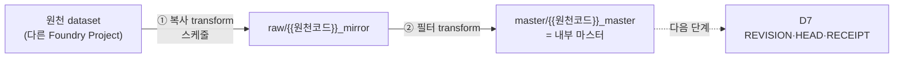

# S1 외부 데이터 가져오기 → 필터 → 내부 마스터 (공개용, 구현 명세)

> 퍼블릭 repo 공유용. 업무 내용은 `{{빈칸}}`.
> **내부 AI에게:** 맨 아래 "채울 것" 표를 먼저 채운다. 모르면 사용자에게 표의 질문을 묻는다. 채운 값은 퍼블릭 repo에 다시 올리지 않는다.

## 규칙 (선행 조건)

1. 모든 외부 데이터는 **dataset으로 우리 Foundry Project 안에 주기적으로 복사**한다. 원천이 raw dataset이든 Materialization (편집이 반영된 dataset)이든 같다.
2. 우리 로직은 **복사본만** 입력으로 쓴다. 원천을 직접 읽는 transform은 복사 transform 1개뿐.
3. 복사본에서 `{{필터 조건}}`에 맞는 행만 골라낸 dataset = **`{{내부 마스터}}` 마스터 dataset**.
4. 리비전 (D7: REVISION · HEAD · RECEIPT)은 이 다음 단계. 이번 범위 밖.

## 흐름



## 폴더

```
{{우리 Foundry Project}}/
  raw/        ← ① 원천 복사본 (원천 1개 = dataset 1개)
  master/     ← ② 필터 결과 = 내부 마스터
  revision/   ← D7 (나중)
```

## ① 복사 transform

- 원천 dataset을 Project Reference (다른 Project의 dataset을 입력으로 씀)로 가져옴. ([Use project references](https://www.palantir.com/docs/foundry/code-repositories/use-project-references))
- 출력 = 매번 전체 교체 (SNAPSHOT). 변환·필터 없음. 스키마 그대로.
- 원천이 Object Type이면: 그 타입에 사용자 편집이 꺼져 있으면 백킹 dataset을 읽음. 편집이 켜져 있으면 Materialization을 읽음. ([Materializations](https://www.palantir.com/docs/foundry/object-edits/materializations/))

```python
from transforms.api import transform_df, Input, Output


@transform_df(
    Output("{{우리 Foundry Project}}/raw/{{원천코드}}_mirror"),
    source=Input("{{원천 dataset 경로}}"),
)
def compute(source):
    # 그대로 복사. 여기서 고르거나 바꾸지 않는다.
    return source
```

## ② 필터 transform

- 입력 = ①의 복사본만.
- 출력 = SNAPSHOT. 조건에 맞는 행만.
- 컬럼은 `{{보관 컬럼 목록}}`만 남김 (전부 남겨도 됨).

```python
from pyspark.sql import functions as F
from transforms.api import transform_df, Input, Output


@transform_df(
    Output("{{우리 Foundry Project}}/master/{{원천코드}}_master"),
    mirror=Input("{{우리 Foundry Project}}/raw/{{원천코드}}_mirror"),
)
def compute(mirror):
    return (
        mirror
        .filter({{필터 조건 식}})          # 예: F.col("{{상태 컬럼}}").isin({{대상 값들}})
        .select({{보관 컬럼 목록}})
    )
```

## 스케줄

- ① = `{{주기}}` 시간 기준 스케줄 (원천 갱신 주기에 맞춤). 또는 원천 dataset 갱신 시 트리거.
- ② = ① 출력이 갱신되면 트리거.
- ([Schedules](https://www.palantir.com/docs/foundry/data-integration/schedules))

## 권한

- 원천 Project는 모든 Foundry 사용자 View로 열려 있음 → 읽기는 문제 없음 (사용자 확인, 10-21).
- 복사본은 **우리 Project 권한**을 따름. 보안 제약대로 우리 Project는 관리자만. 원천이 열려 있다고 복사본도 열리면 안 됨.
- 원천 dataset에 Marking이 있으면 복사본으로 전파됨. 지금 원천은 Marking 없음 (10-06 관찰).

## 완료 기준

- [ ] ① 빌드 성공. 행 수 = 원천 행 수.
- [ ] ② 빌드 성공. 행 수 = 조건 맞는 원천 행 수 (원천에서 직접 세어 비교).
- [ ] 스케줄 1회 자동 실행 확인.
- [ ] 우리 Project 권한: 관리자 외 사용자가 dataset을 못 봄 (퀵서치 포함).

## 다음 단계와 이어지는 점 (D7)

- REVISION은 **② 필터 결과**를 입력으로 쓴다 (제안). 관심 행만 리비전.
- 그러면 행이 필터 밖으로 나가도 "사라짐"으로 보임 → 원천 삭제와 구분 필요. `change_type`에 `OUT_OF_SCOPE` 추가 제안 (①에 행이 있으면 OUT_OF_SCOPE, 없으면 DELETE).

## 채울 것 (내부 AI)

| 빈칸 | 뜻 | 어디서 확인 | 모르면 사용자에게 |
|---|---|---|---|
| `{{우리 Foundry Project}}` | 우리 Project 경로 | Compass | "우리 Project 경로는?" |
| `{{원천 dataset 경로}}` | 원천 dataset | 원천 Project | "가져올 원천 dataset 경로는?" |
| `{{원천코드}}` | 원천 짧은 코드 | - | "원천 이름 약어는?" |
| `{{내부 마스터}}` | 내부 마스터 이름 | 우리 설계 | "필터 결과 마스터 이름은?" |
| `{{필터 조건}}` / `{{필터 조건 식}}` | 고를 행 조건 | 업무 규칙 | "어떤 조건의 행만 가져오나?" |
| `{{보관 컬럼 목록}}` | 남길 컬럼 | 원천 스키마 | "어느 컬럼을 남기나? 전부?" |
| `{{주기}}` | 복사 주기 | 원천 동기화 주기 (History 탭) | "몇 시간마다 가져오나?" |
