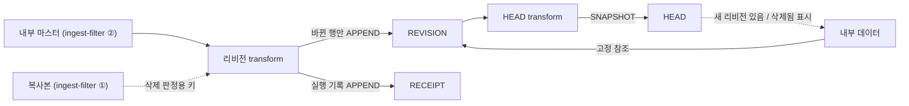

# D7 원천 리비전 격리 (공개용)

> 이 문서는 퍼블릭 repo로 공유된다. 업무 내용은 `{{빈칸}}`으로 둔다.
> **내부 AI에게:** 맨 아래 "채울 것" 표를 먼저 채운다. 모르면 사용자에게 표의 질문을 그대로 묻는다. 채운 값은 퍼블릭 repo에 다시 올리지 않는다.

## 결론

- `{{원천 엔티티}}` 데이터는 우리 Foundry Project 안 전용 폴더에 **행별 리비전**으로 복사해 쌓는다.
- 리비전 번호는 **0부터**. 새 행 = 0, 바뀔 때마다 +1.
- 내부 엔티티 `{{내부 엔티티}}`는 `(src_system, 원천 키, src_rev_no)`로 **고정 참조**한다.
- 원천이 바뀌어도 내부 값은 안 바뀐다. "새 리비전 있음" 표시만 한다.
- 고정 리비전 올리기 = 담당자 Action만.

## 왜

- 원천이 바뀌어도 담당자 의도 없이 내부 데이터가 바뀌면 안 됨.
- 원천 쪽이 데이터를 지워도 우리 쪽에 남아야 함 → Project Reference (다른 Foundry Project 데이터셋을 입력으로 씀)만으로는 부족. 복사.
- 원천 동기화는 매번 SNAPSHOT (전체 교체) → 이력은 우리가 쌓음.
- Foundry 트랜잭션 이력에 기대지 않음 (원천 쪽 소유, 보존 정책 확인 필요).

## 데이터셋 3개 (새로 만든 HEAD · REVISION · RECEIPT)

> 2026-10-21 변경: 기존 3개를 고치지 않고 새 데이터셋 3개를 만들었다. Object Type도 새로 만든다 (아래 "전환 작업").

| 데이터셋 | 역할 | 쓰기 | 행 단위 |
|---|---|---|---|
| REVISION | 모든 리비전. 고정 참조 대상 (원장) | incremental APPEND | 키 × `src_rev_no` |
| HEAD | 키별 최신 1행. 비교용 | REVISION에서 매번 재계산 (SNAPSHOT) | 키 |
| RECEIPT | 수신 기록. 동기화 1회 = 1행 | incremental APPEND | 실행 1회 (구현 명세에서 확정) |

- 원천 리비전 폴더와 내부 폴더 분리. 내부 → 원천 리비전 폴더로 쓰기 없음.
- 연동 원천이 여러 개: REVISION · HEAD · RECEIPT 모두 원천별 1세트. dataset 1개는 transform 1개만 쓸 수 있어서 RECEIPT도 원천별로 둔다. 한 번에 보고 싶으면 `RECEIPT_ALL` (원천별 RECEIPT union, SNAPSHOT)을 따로 만든다. 원천 목록은 설정 파일 + generated transform.
- 권한: REVISION · HEAD는 edit-only 속성 `viewerGroupIds` (Action으로만 채움). RECEIPT는 키가 없어서 행별 그룹이 아니라 앱 사용자 그룹 상수 조건으로 본다 ([basic-info-ui.md](basic-info-ui.md) "원천 객체 권한"). transform은 권한 컬럼을 안 씀.

## 입력 (사용자 결정, 10-21)

- REVISION 입력 = ingest-filter ② 필터 결과 (내부 마스터). 원천을 직접 안 읽음.
- 복사본(ingest-filter ①)이 갱신될 때마다 → 필터 → 바뀐 행만 리비전.
- DELETE 판정은 복사본 기준: 마스터에 없고 복사본에도 없으면 DELETE, 복사본엔 있으면 OUT_OF_SCOPE. 이미 사라진 키도 이 기준이 바뀌면 새 리비전 (DELETE ↔ OUT_OF_SCOPE). 상세는 구현 명세 판정표.

## REVISION 컬럼

| 컬럼 | 뜻 |
|---|---|
| `src_system` | 원천 코드 `{{원천 코드 목록}}` |
| `{{원천 키 컬럼}}` | 원천 업무 키 |
| `src_rev_no` | 0부터, 키별 증가 |
| `change_type` | INSERT / UPDATE / DELETE / REINSERT / OUT_OF_SCOPE |
| `row_hash` | 비교 컬럼 `{{비교 컬럼 목록}}`의 해시 (구현 명세 해시 규칙) |
| `receipt_id` | 이 리비전을 만든 RECEIPT 행 |
| `captured_at` | 감지 시각 |
| `{{원천 업무 컬럼들}}` | 그 리비전의 값 |

PK = `src_system` + `_` + 키 + `_` + `src_rev_no`. HEAD PK = `src_system` + `_` + 키.

## 리비전 규칙 (실행 1회)

1. 내부 마스터 · 복사본 전체 (`snapshot_inputs`) + 이전 REVISION 출력 (`output.dataframe('previous')`) 읽기. ([Create a historical dataset](https://www.palantir.com/docs/foundry/transforms-python/create-historical-dataset))
2. 키별 최신과 `row_hash` 비교:
   - 새 키 → 0, INSERT
   - 해시 다름 → +1, UPDATE
   - 같음 → 안 씀
   - 원천에서 사라짐 → +1, DELETE (값은 마지막 값 유지, 화면에 "원천에서 삭제됨")
   - 사라졌다 다시 나타남 → +1, REINSERT
   - 복사본엔 있는데 필터 밖으로 나감 → +1, OUT_OF_SCOPE (원천 삭제와 구분)
   - OUT_OF_SCOPE였는데 복사본에서도 사라짐 → +1, DELETE. DELETE였는데 복사본에만 다시 나타남 → +1, OUT_OF_SCOPE
3. 바뀐 행 REVISION APPEND + 실행 기록 RECEIPT APPEND.
4. HEAD 재계산.

확인 필요: incremental transform 1개가 출력 2개를 같이 쓰기. 안 되면 RECEIPT를 별도 transform으로.

구현: [source-revision-impl.md](source-revision-impl.md)

## 화면 표시 (구분)

- 원천 리비전: `{{원천 엔티티 약어}} v0, v1…`
- 내부 리비전: `{{내부 엔티티 약어}} R00, R01…`
- 약어는 첫 글자가 같아도 됨. `v` / `R`로 종류를 구분.

## 리스크

- 비교 컬럼 바뀌면 전체 행 새 리비전 → 비교 컬럼 목록 고정.
- 정규화 안 하면 가짜 변경 → 해시 전 앞뒤 공백 제거 + null 기호 처리 + 타입별 문자열 형식 고정 (구현 명세 해시 규칙). 숫자 값 정규화·대소문자 정규화는 안 함.
- `semantic_version` 올리면 비증분 + 출력 교체 → 이력 손실 ([구현 명세 "이력 보호"](source-revision-impl.md)).
- 원천 키가 바뀌면 삭제 + 새 행으로 보임 → 원천 쪽과 키 불변 합의.

## 전환 작업

- 결정 (2026-10-21): 기존 3개 데이터셋은 고치지 않는다. **새 데이터셋 3개 + 새 Object Type 3개**로 시작한다. rev는 0부터.
- 이유: 기존 예제 값은 Function/Action으로 넣어서 edits로 남아 있다. 편집이 우선이라서 같은 PK면 새 transform 값이 가려진다. ([How user edits are applied](https://www.palantir.com/docs/foundry/object-edits/how-edits-applied/))
- 그래서 기존 Object Type의 데이터소스만 새 데이터셋으로 바꾸지 않는다.

### 전제조건 (먼저 확인. 하나라도 아니면 멈추고 사용자에게 묻는다)

| # | 조건 | 왜 | 근거 |
|---|---|---|---|
| P1 | 새 Object Type은 **project-based 권한 모델**로 만든다 (`{{권한 모델}}` 확인) | legacy(datasource-derived) 모델은 행 정책이 있어도 백킹 데이터셋 Viewer가 필요하다. Viewer를 주면 데이터셋에서 모든 행이 보여서 행 권한이 소용없다 | [Object security policies](https://www.palantir.com/docs/foundry/object-permissioning/object-security-policies/) |
| P2 | 새 Object Type은 **OSv2** (Object Storage v2) | edit-only 속성은 OSv2에서만 된다 | [Edit-only properties](https://www.palantir.com/docs/foundry/object-link-types/edit-only-properties) |
| P3 | `{{플랫폼 버전}}`에서 P1·P2 설정이 있다 | 공식 문서는 최신 버전 기준 | 확인 필요 |

### 새 Object Type 만들기 (3개 모두, P1~P3 통과 후)

| 단계 | 할 일 | 확인 |
|---|---|---|
| 1 | 새 데이터셋으로 Object Type 생성. PK = REVISION `revision_pk`, HEAD `head_pk`, RECEIPT `receipt_id` | PK 중복 0 |
| 2 | REVISION · HEAD: Create Property → Data에서 edit-only 토글을 켜고 `viewerGroupIds` (array<string>) 추가 | 속성이 edit-only로 표시됨 ([Edit-only properties](https://www.palantir.com/docs/foundry/object-link-types/edit-only-properties)) |
| 3 | REVISION · HEAD: Object Type의 Edits 옵션 켬. UI 라벨은 `{{플랫폼 버전}}`에서 확인 필요 ([Allow editing](https://www.palantir.com/docs/foundry/object-link-types/allow-editing)) | Action 편집 가능 |
| 4 | 행 정책. REVISION · HEAD = 현재 사용자 Group IDs includes any of `viewerGroupIds`, 또는 `{{관리자 그룹}}` 상수. RECEIPT = `{{앱 사용자 그룹}}` 상수 | 일반 사용자 0건 (REVISION · HEAD), 관리자 전체 |
| 5 | 권한 배정 = 재동기화 Action ([basic-info-ui.md](basic-info-ui.md)) | 배정한 그룹 사용자만 보임 |

- 4단계의 "OR + 상수 그룹 조건"은 공식 문서에서 못 찾음. 다른 Foundry 환경 PoC에서는 됐다 (PoC 관찰). 안 되면 `{{관리자 그룹}}` ID를 모든 행 `viewerGroupIds`에 함께 넣는다.
- 새 객체는 `viewerGroupIds`가 비어 있다 → 권한 배정 전에는 관리자만 본다. 이것이 정상이다.
- 정책이 없는 Object Type은 백킹 데이터소스 권한을 따른다 (문서). 그래서 4단계를 빼먹으면 안 된다.

기존 3개 정리 순서: Deprecated 표시 → 앱·Function을 새 타입으로 전환 → 기존 Object Type 삭제 → 기존 데이터셋 삭제 (`{{기존 데이터 보관 여부}}` 확인 후).

## 채울 것 (내부 AI)

| 빈칸 | 뜻 | 어디서 확인 | 모르면 사용자에게 |
|---|---|---|---|
| `{{원천 엔티티}}` | 최상위 원천 데이터 이름 | 원천 데이터셋 | "최상위 원천 데이터의 이름은?" |
| `{{내부 엔티티}}` | 우리가 만드는 데이터 이름 | 우리 object type | "내부에서 만드는 객체 이름은?" |
| `{{기존 데이터 보관 여부}}` | 기존 3개 데이터셋을 지울지 | 사용자 결정 (기존 데이터셋 소유자) | "기존 예제 데이터셋 3개는 지워도 되나, 보관하나?" |
| `{{권한 모델}}` | 대상 온톨로지 권한 모델 | Ontology Manager → Object Type → Security 탭 | "새 Object Type을 project-based 권한으로 만들 수 있나?" |
| `{{플랫폼 버전}}` | Foundry 버전 | Foundry 화면 버전 정보 | "지금 Foundry 버전은?" |
| `{{관리자 그룹}}` | 모든 행을 보는 관리자 그룹 ID | 권한 설계 문서 | "모든 원천 행을 보는 관리자 그룹 ID는?" |
| `{{앱 사용자 그룹}}` | 앱을 쓰는 사용자 전체 그룹 ID | 권한 설계 문서 | "앱 사용자 전체를 담은 그룹 ID는?" |
| `{{원천 엔티티 약어}}` / `{{내부 엔티티 약어}}` | 화면 표시 약어 | 사용자 결정 (화면 기획) | "화면에 쓸 약어는?" |
| `{{원천 코드 목록}}` | 원천별 `src_system` 값 | 연동 목록 | "연동 원천 목록과 코드는?" |
| `{{원천 키 컬럼}}` | 원천의 업무 키 | 원천 스키마 | "원천마다 업무 키 컬럼은?" |
| `{{비교 컬럼 목록}}` | 변경 감지 컬럼 | 원천 스키마 | "어느 컬럼이 바뀌면 리비전인가?" |
| `{{원천 업무 컬럼들}}` | 복사할 컬럼 | 원천 스키마 | "어느 컬럼을 보관하나?" |
