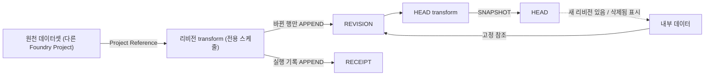

# D7 원천 리비전 격리 (공개용)

> 이 문서는 퍼블릭 repo로 공유된다. 업무 내용은 `{{빈칸}}`으로 둔다.
> **내부 AI에게:** 맨 아래 "채울 것" 표를 먼저 채운다. 모르면 사용자에게 표의 질문을 그대로 묻는다. 채운 값은 퍼블릭 repo에 다시 올리지 않는다.

## 결론

- `{{원천 엔티티}}` 데이터는 우리 Foundry Project 안 전용 폴더에 **행별 리비전**으로 복사해 쌓는다.
- 리비전 번호는 **0부터**. 새 행 = 0, 바뀔 때마다 +1.
- 내부 엔티티 `{{내부 엔티티}}`는 `(src_system, 원천 키, src_rev_no)`로 **고정 참조**한다.
- 원천이 바뀌어도 내부 값은 안 바뀐다. "새 리비전 있음" 표시만 한다.
- 고정 리비전 올리기 = 담당자 Action만.

## 왜

- 원천이 바뀌어도 담당자 의도 없이 내부 데이터가 바뀌면 안 됨.
- 원천 쪽이 데이터를 지워도 우리 쪽에 남아야 함 → Project Reference (다른 Foundry Project 데이터셋을 입력으로 씀)만으로는 부족. 복사.
- 원천 동기화는 매번 SNAPSHOT (전체 교체) → 이력은 우리가 쌓음.
- Foundry 트랜잭션 이력에 기대지 않음 (원천 쪽 소유, 보존 정책 확인 필요).

## 데이터셋 3개 (기존 HEAD · REVISION · RECEIPT)

| 데이터셋 | 역할 | 쓰기 | 행 단위 |
|---|---|---|---|
| REVISION | 모든 리비전. 고정 참조 대상 (원장) | incremental APPEND | 키 × `src_rev_no` |
| HEAD | 키별 최신 1행. 비교용 | REVISION에서 매번 재계산 (SNAPSHOT) | 키 |
| RECEIPT | 수신 기록. 동기화 1회 = 1행 | incremental APPEND | 실행 1회 (`{{확인: 지금 행 단위}}`) |

- 원천 리비전 폴더와 내부 폴더 분리. 내부 → 원천 리비전 폴더로 쓰기 없음.
- 연동 원천이 여러 개: REVISION · HEAD는 원천별 1세트, RECEIPT는 공용 1개 (`src_system`으로 구분). 원천 목록은 설정 파일 + generated transform.
- 권한 속성 `viewerGroupIds`는 3개 모두 edit-only (Action으로만 채움). transform은 권한 컬럼을 안 씀.

## 입력 (사용자 결정, 10-21)

- REVISION 입력 = ingest-filter ② 필터 결과 (내부 마스터). 원천을 직접 안 읽음.
- 복사본(S1 ①)이 갱신될 때마다 → 필터 → 바뀐 행만 리비전.
- DELETE 판정은 복사본 기준: 복사본에도 없으면 DELETE, 복사본엔 있으면 OUT_OF_SCOPE.

## REVISION 컬럼

| 컬럼 | 뜻 |
|---|---|
| `src_system` | 원천 코드 `{{원천 코드 목록}}` |
| `{{원천 키 컬럼}}` | 원천 업무 키 |
| `src_rev_no` | 0부터, 키별 증가 |
| `change_type` | INSERT / UPDATE / DELETE / REINSERT / OUT_OF_SCOPE |
| `row_hash` | 비교 컬럼 `{{비교 컬럼 목록}}`의 해시 (정규화 후) |
| `receipt_id` | 이 리비전을 만든 RECEIPT 행 |
| `captured_at` | 감지 시각 |
| `{{원천 업무 컬럼들}}` | 그 리비전의 값 |

PK = `src_system` + `_` + 키 + `_` + `src_rev_no`. HEAD PK = `src_system` + `_` + 키.

## 리비전 규칙 (실행 1회)

1. 원천 전체 (`snapshot_inputs`) + 이전 REVISION 출력 (`output.dataframe('previous')`) 읽기. ([Create a historical dataset](https://www.palantir.com/docs/foundry/transforms-python/create-historical-dataset))
2. 키별 최신과 `row_hash` 비교:
   - 새 키 → 0, INSERT
   - 해시 다름 → +1, UPDATE
   - 같음 → 안 씀
   - 원천에서 사라짐 → +1, DELETE (값은 마지막 값 유지, 화면에 "원천에서 삭제됨")
   - 사라졌다 다시 나타남 → +1, REINSERT
   - 복사본엔 있는데 필터 밖으로 나감 → +1, OUT_OF_SCOPE (원천 삭제와 구분)
3. 바뀐 행 REVISION APPEND + 실행 기록 RECEIPT APPEND.
4. HEAD 재계산.

확인 필요: incremental transform 1개가 출력 2개를 같이 쓰기. 안 되면 RECEIPT 분리.

## 화면 표시 (구분)

- 원천 리비전: `{{원천 엔티티 약어}} v0, v1…`
- 내부 리비전: `{{내부 엔티티 약어}} R00, R01…`
- 약어는 첫 글자가 같아도 됨. `v` / `R`로 종류를 구분.

## 리스크

- 비교 컬럼 바뀌면 전체 행 새 리비전 → 비교 컬럼 목록 고정.
- 정규화 안 하면 가짜 변경 → 해시 전 공백·숫자·null 정규화.
- `semantic_version` 올리면 replace 모드 → 이력 손실 위험 (확인 필요).
- 원천 키가 바뀌면 삭제 + 새 행으로 보임 → 원천 쪽과 키 불변 합의.

## 전환 작업

- 지금 예제 데이터는 Function으로 넣었고 1부터 시작 → 지우고 transform으로 0부터.
- Function/Action 값은 edits로 남고 편집이 우선 → 예제 edits 먼저 삭제 (또는 새 object type). ([How user edits are applied](https://www.palantir.com/docs/foundry/object-edits/how-edits-applied/))

## 채울 것 (내부 AI)

| 빈칸 | 뜻 | 어디서 확인 | 모르면 사용자에게 |
|---|---|---|---|
| `{{원천 엔티티}}` | 최상위 원천 데이터 이름 | 원천 데이터셋 | "최상위 원천 데이터의 이름은?" |
| `{{내부 엔티티}}` | 우리가 만드는 데이터 이름 | 우리 object type | "내부에서 만드는 객체 이름은?" |
| `{{원천 엔티티 약어}}` / `{{내부 엔티티 약어}}` | 화면 표시 약어 | - | "화면에 쓸 약어는?" |
| `{{원천 코드 목록}}` | 원천별 `src_system` 값 | 연동 목록 | "연동 원천 목록과 코드는?" |
| `{{원천 키 컬럼}}` | 원천의 업무 키 | 원천 스키마 | "원천마다 업무 키 컬럼은?" |
| `{{비교 컬럼 목록}}` | 변경 감지 컬럼 | 원천 스키마 | "어느 컬럼이 바뀌면 리비전인가?" |
| `{{원천 업무 컬럼들}}` | 복사할 컬럼 | 원천 스키마 | "어느 컬럼을 보관하나?" |
| `{{확인: 지금 행 단위}}` | 지금 RECEIPT 행 단위 | 현재 RECEIPT 데이터셋 | "RECEIPT는 실행 1회 1행? 키별 1행?" |
